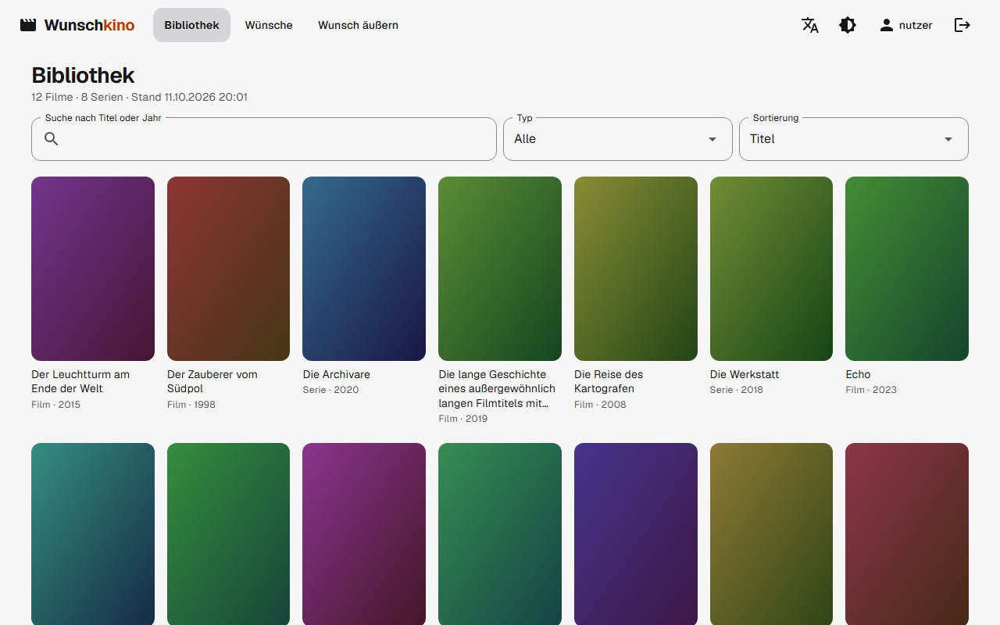
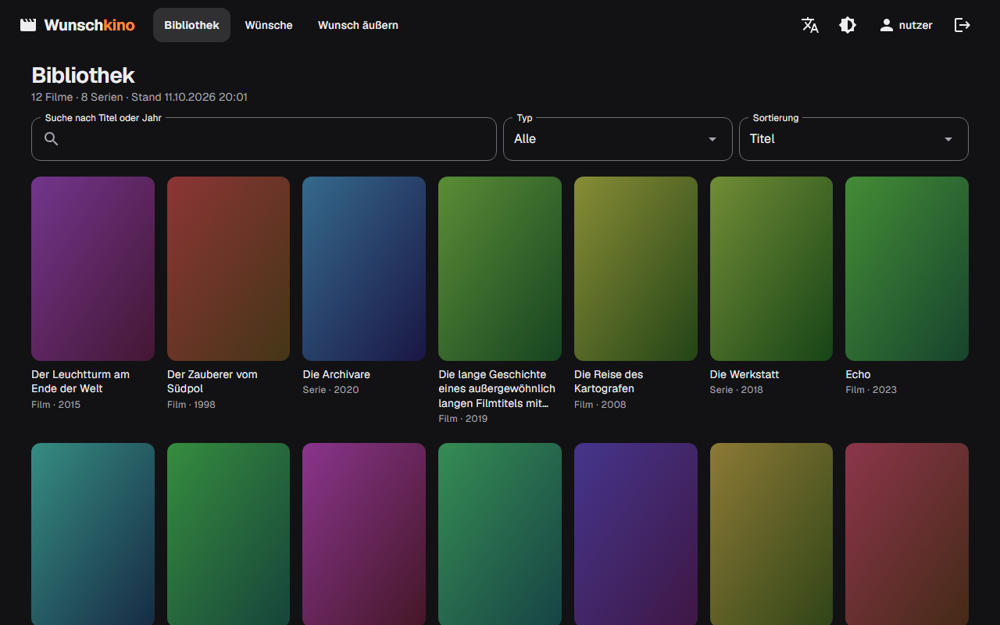
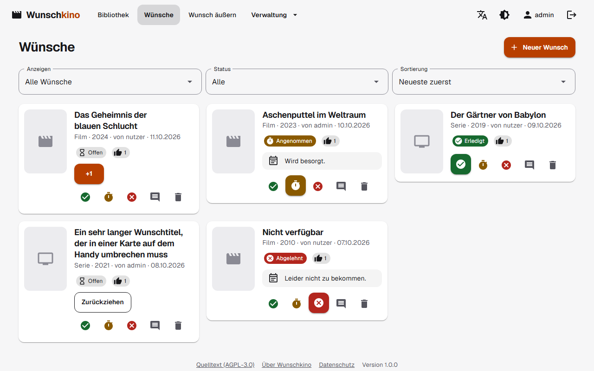
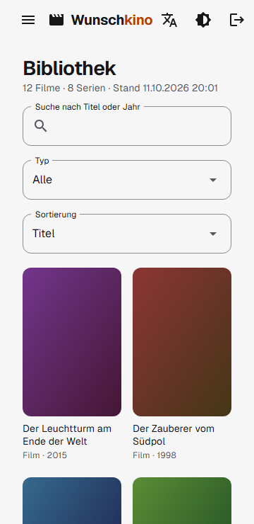
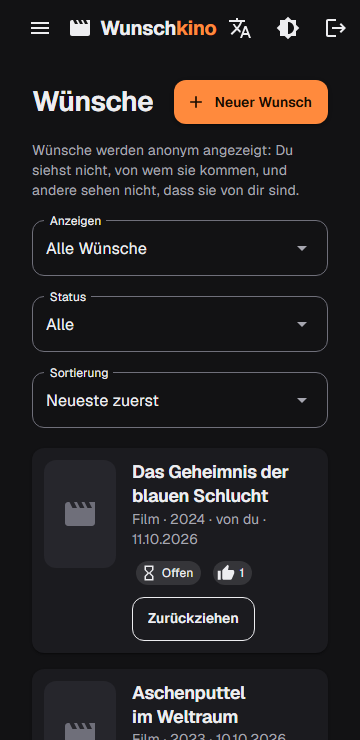

# Wunschkino – a wish portal for Jellyfin

**Deutsch** · [English](README.en.md)

> Ein kleines, selbst gehostetes Portal, in dem Familie und Freunde sich neue Filme, Serien und Anime wünschen. Es lädt nichts herunter; ein Admin pflegt die Wünsche.

Wunschkino ist ein Webportal für **Familie und Freunde** zu einer bestehenden [Jellyfin](https://jellyfin.org/)-Installation. Alle sehen, welche Filme und Serien schon da sind, und können sich neue Titel **wünschen**. Ein Admin pflegt die Wünsche. Kein Konto bei einem Fremddienst nötig, die Nutzer legt der Admin selbst an.

## Funktionen

- **Bibliothek:** Poster-Raster aller Filme und Serien aus Jellyfin mit Suche, Filter (Film/Serie) und Sortierung. Die Bilder laufen über den Server, der Jellyfin-Schlüssel erreicht nie den Browser.
- **Wünschen:** Suche nach Titel oder IMDb-Nummer (`tt0133093`). Jedes Ergebnis zeigt, ob der Titel schon in Jellyfin liegt, schon gewünscht wurde oder noch wünschbar ist. Optional mit Notiz.
- **Kein doppelter Wunsch, „+1“:** Jeder Titel wird nur einmal gewünscht. Weitere Nutzer schließen sich per „+1“ an.
- **Anime:** Eigene Suche über [AniList](https://anilist.co/) (auch Romaji- und japanische Titel), ohne Konto. Gewünscht wird die ganze Serie über ihre TMDB-Nummer.
- **Wunschlisten:** „Alle Wünsche“ und „Meine Wünsche“ mit Status (Offen, Angenommen, Abgelehnt, Erledigt), Filter und Sortierung.
- **Admin:** Status per Klick (grüner Haken, gelbe Stoppuhr, rotes X), Kommentar, Löschen, Benutzerverwaltung (anlegen, sperren, Passwort zurücksetzen, Rollen).
- **Automatisch erledigt:** Taucht ein gewünschter Titel nach dem nächsten Abgleich in Jellyfin auf, setzt Wunschkino den Wunsch selbst auf „Erledigt“.
- **Fehlende Folgen:** Admins sehen, welche Folgen einer Serie in Jellyfin fehlen (Vergleich mit TMDB), getrennt nach sicheren Fällen und unsicherer Zählung, wie sie bei Anime vorkommt.
- **Sicher gebaut:** Passwörter mit Argon2, optionale Zwei-Faktor-Anmeldung (TOTP) pro Konto, gestaffelte Sperre von Adressen nach Fehlversuchen (bis dauerhaft, vom Admin entsperrbar), Rate-Limit, strenge Security-Header (CSP), API-Schlüssel verschlüsselt in der Datenbank, Herkunftsbestätigung der Releases.

## Screenshots

Alle Bilder zeigen Demo-Daten mit selbst gezeichneten Postern.





 

## Voraussetzungen

- Ein Server mit **Debian 12**, **Ubuntu 24.04** oder einem davon abgeleiteten System (x86-64 oder arm64) mit systemd. Getestet sind Debian 12 und Ubuntu 24.04.
- Ein erreichbarer **Jellyfin**-Server und ein **API-Schlüssel** (Jellyfin → Dashboard → API-Schlüssel).
- Ein kostenloser **TMDB-API-Schlüssel** ([themoviedb.org](https://www.themoviedb.org/settings/api)). Der v3-Schlüssel und der v4-Lesezugriffs-Token funktionieren beide.
- Ein **Reverse-Proxy mit HTTPS**, zum Beispiel [Nginx Proxy Manager](https://nginxproxymanager.com/). Die Anmeldung funktioniert aus Sicherheitsgründen nur über HTTPS (siehe [Fehlersuche](#fehlersuche)).
- Ein aktueller **Browser** für die Nutzer (Chromium-basiert, Firefox oder Safari, jeweils die letzten zwei Hauptversionen). Getestet wird mit Chromium.

## Installation

Ein Befehl auf dem Server installiert alles (als root bzw. mit `sudo`):

Läuft Dein Reverse-Proxy auf **einem anderen Server** (oder in Docker):

```bash
curl -fsSL https://github.com/dahamalp/Wunschkino/releases/latest/download/install.sh | sudo bash -s -- --proxy-mode remote --proxy <IP-des-Proxy-Servers>
```

Ersetze `<IP-des-Proxy-Servers>` durch die IP-Adresse des Rechners, auf dem Dein Reverse-Proxy läuft. Läuft der Proxy in Docker, ist das die Adresse des Servers, auf dem der Container läuft. **Ohne diese Angabe sehen alle Nutzer wie die Adresse des Proxys aus und teilen sich Login-Limit und Sperre.**

Läuft Dein Reverse-Proxy auf **demselben Server** (ohne Docker), nimm stattdessen `--proxy-mode local`. Die App lauscht dann nur auf `127.0.0.1`, ein Port nach außen ist nicht offen:

```bash
curl -fsSL https://github.com/dahamalp/Wunschkino/releases/latest/download/install.sh | sudo bash -s -- --proxy-mode local
```

Das Script legt einen Systemnutzer, `/opt/wunschkino`, `/var/lib/wunschkino` und `/etc/wunschkino` an, lädt das neueste Release samt Prüfsumme und Herkunftsprüfung, richtet einen gehärteten systemd-Dienst ein und wartet, bis der Dienst gesund ist. Am Ende zeigt es die Adresse, das **Setup-Token** und eine Anleitung für den Proxy an. Dazu legt es den Hilfsbefehl `wunschkino-admin` an (siehe [Gesperrte Adressen](#gesperrte-adressen)).

**Wichtig bis zur Einrichtung:** Solange der Einrichtungsassistent offen ist, kann jeder die Einrichtungsseite aufrufen, der den Port des Servers erreicht. Schließe die Einrichtung deshalb direkt nach der Installation ab, und lass den Port nicht ungeschützt im Netz offen (`--proxy-mode local` oder eine Firewall, die nur den Proxy-Server hineinlässt). Das Script warnt, wenn die App offen und ohne Proxy-Angabe läuft.

Der Installer funktioniert ab dem ersten veröffentlichten Release. Mit `--help` listet er alle Optionen:

```bash
curl -fsSL https://github.com/dahamalp/Wunschkino/releases/latest/download/install.sh | bash -s -- --help
```

### Herkunft des Pakets prüfen

Jedes Release enthält Prüfsummen und eine **Herkunftsbestätigung** (Attestierung): Sie belegt, dass die Pakete und das Install-Script im Release-Workflow dieses Repositories gebaut wurden. Der Installer prüft das mit der [GitHub-CLI](https://cli.github.com/) (`gh`), wenn sie installiert ist; sonst gibt er einen Hinweis. Von Hand:

```bash
gh attestation verify wunschkino-vX.Y.Z-linux-x64.tar.gz --repo dahamalp/Wunschkino
gh attestation verify install.sh --repo dahamalp/Wunschkino
```

Wer vorsichtig sein will, führt das Script nicht direkt aus der Pipe aus, sondern lädt es zuerst: `curl -fsSLO https://github.com/dahamalp/Wunschkino/releases/latest/download/install.sh`, dann `gh attestation verify install.sh --repo dahamalp/Wunschkino`, dann `sudo bash install.sh …`.

Mit `--require-attestation true` bricht der Installer ab, wenn die Herkunft nicht bestätigt werden kann. `--require-attestation false` schaltet die Prüfung aus (etwa wenn `gh` nicht bei GitHub angemeldet ist oder kein Netz hat). Die Prüfsumme allein schützt nur vor beschädigten Downloads, nicht vor einem veränderten Release.

### Optionen

Jede Option gibt es auch als Umgebungsvariable `WK_<NAME>` (zum Beispiel `WK_PORT=8080`).

| Option | Bedeutung |
|---|---|
| `--proxy-mode MODUS` | `local`: Der Reverse-Proxy läuft auf demselben Server, die App lauscht nur auf `127.0.0.1`. `remote`: Der Proxy läuft woanders, `--proxy` ist dann Pflicht. Der Installer lehnt widersprüchliche Angaben ab. |
| `--proxy LISTE` | IP-Adresse(n) oder Netz(e) Deines Reverse-Proxys, etwa `192.168.1.10` oder `10.0.0.0/24` (Netzadresse, kein Rechner im Netz). Nur von ihnen übernimmt die App die echte Client-IP; sie werden nie gesperrt. |
| `--allow-downgrade` | Erlaubt eine ältere Version als die installierte. Ohne die Option lehnt das Script ein Downgrade ab. |
| `--require-attestation M` | `auto` (Standard): Herkunft des Pakets mit `gh` prüfen, wenn vorhanden. `true`: ohne erfolgreiche Prüfung abbrechen. `false`: nicht prüfen. |
| `--domain HOSTS` | Öffentliche Domain(s), kommagetrennt. Beschränkt die erlaubten Host-Header (`localhost` bleibt für den Health-Check erlaubt). |
| `--port N` | HTTP-Port der App, Standard `8080`. |
| `--bind ADRESSE` | Lausch-Adresse: IP, `localhost` oder `*` (alle Schnittstellen, Standard). `--proxy-mode local` setzt sie auf `127.0.0.1`. |
| `--secure-cookies B` | `true` (Standard) oder `false`. Nur für den bewussten Betrieb ohne HTTPS im eigenen Netz. |
| `--version vX.Y.Z` | Bestimmte Version statt der neuesten. |
| `--repo OWNER/NAME` | GitHub-Repository der Releases, zum Beispiel für einen Fork. |
| `--source-url URL` | Quelltext-Adresse, die die App allen Nutzern zeigt (AGPL). Standard: `https://github.com/<--repo>`; nur für andere Hosts wie Codeberg nötig. |
| `--user`, `--install-dir`, `--data-dir`, `--config-dir` | Systemnutzer und Pfade, falls die Standardwerte nicht passen. |
| `--uninstall` / `--purge` | Entfernen (Daten bleiben) bzw. vollständig entfernen (auch Daten, Sicherungen, Konfiguration, Systemnutzer). |

### Nginx Proxy Manager einrichten

1. **Hosts → Proxy Hosts → Add Proxy Host**
2. **Domain Names:** Deine Domain, zum Beispiel `wunsch.example.org`
3. **Scheme** `http`, **Forward Hostname/IP:** IP des Wunschkino-Servers, **Forward Port:** `8080` (oder Dein `--port`)
4. **Websockets Support: einschalten.** Ohne WebSockets funktioniert die Oberfläche nicht.
5. Reiter **SSL:** neues Zertifikat (Let's Encrypt) anfordern, **Force SSL** und **HSTS Enabled** einschalten. **HSTS Subdomains** nur, wenn wirklich alle Subdomains Deiner Domain HTTPS sprechen.
6. Der Port muss vom Proxy-Server aus erreichbar sein, aber **nur** von dort: Erlaube ihn in der Firewall des Wunschkino-Servers ausschließlich für die IP des Proxy-Servers, zum Beispiel mit `sudo ufw allow from <IP des Proxys> to any port 8080 proto tcp`.

Trage danach die IP des Proxy-Servers mit `--proxy` ein, falls Du es bei der Installation noch nicht getan hast.

### Ersteinrichtung

Öffne Wunschkino über Deine Domain. Der Einrichtungsassistent führt durch fünf Schritte:

1. **Setup-Token** eingeben (steht am Ende der Installation und in `/var/lib/wunschkino/setup-token`).
2. **Admin-Konto** anlegen (Passwort mindestens 12 Zeichen).
3. **Jellyfin** verbinden: Adresse (zum Beispiel `http://192.168.1.10:8096`) und API-Schlüssel. Die Verbindung wird sofort getestet.
4. **TMDB-Schlüssel** eintragen, ebenfalls mit Test.
5. Abschließen. Danach ist der Assistent gesperrt und das Token gelöscht.

Weitere Nutzer legst Du unter **Benutzer** an. Eine Selbstregistrierung gibt es bewusst nicht. Die Verbindungen und das Abgleich-Intervall änderst Du später unter **Einstellungen**.

## Betrieb

**Update:** derselbe Installationsbefehl noch einmal. Bei einem Update sichert das Script Datenbank und Schlüssel, prüft die Einstellungen, tauscht die Version und prüft, ob der Dienst gesund ist. Schlägt etwas fehl, **rollt es automatisch zurück** (Programm, Datenbank und Einstellungen). Bestehende Einstellungen und Pfade bleiben erhalten, Du musst Optionen nicht wiederholen. Ein Wert ändert sich nur, wenn Du ihn angibst; `--domain ''` entfernt eine Einstellung.

**Deinstallation:** `… | sudo bash -s -- --uninstall` (Daten bleiben) oder `--uninstall --purge` (alles löschen).

| Was | Wo |
|---|---|
| Programm | `/opt/wunschkino` |
| Daten (Datenbank, Schlüssel) | `/var/lib/wunschkino` |
| Datensicherungen vor Updates (letzte 5) | `/var/lib/wunschkino-backups` |
| Tägliche Datensicherung der App (letzte 7, nur die Datenbank) | `/var/lib/wunschkino/backups` |
| Einstellungen der Installation | `/etc/wunschkino/wunschkino.env` |
| Logs | `journalctl -u wunschkino -f` |
| Zustand | `curl http://127.0.0.1:8080/health` |

Die Zuordnungsliste für Anime (öffentliche Datei auf GitHub, rund 6 MB) lädt Wunschkino einmal täglich selbst nach.

### Gesperrte Adressen

Wunschkino sperrt Absender-Adressen, die sich mehrfach falsch anmelden oder die App überlasten. Nach je **3 Fehlversuchen** wird die Adresse für **1 Minute**, **5 Minuten**, **15 Minuten**, **1 Stunde** und **24 Stunden** gesperrt, danach **dauerhaft**, bis ein Admin entsperrt. Ein Konto sperrt das nie; die Sperre trifft nur die Adresse. Der Server selbst und die mit `--proxy` eingetragenen Proxys werden nie gesperrt. Eine erfolgreiche Anmeldung senkt den Zähler der Adresse um eins, 30 Tage ohne Fehlversuch setzen ihn zurück.

- **In der Oberfläche:** Admins sehen unter **Gesperrte Adressen** alle Adressen mit Zustand und entsperren sie per Klick.
- **Auf dem Server:** Ist der Admin selbst gesperrt, hilft der Hilfsbefehl, den der Installer anlegt:

  ```bash
  sudo wunschkino-admin --list-blocks          # alle Adressen mit Fehlversuchen und Sperren
  sudo wunschkino-admin --unblock 203.0.113.7  # eine Adresse entsperren (IPv4 oder IPv6)
  sudo wunschkino-admin --unblock-all          # alle entsperren
  ```

  Die laufende App übernimmt das innerhalb weniger Sekunden.
- **Fail2ban und Co.:** Jeder Fehlversuch steht im Log (`journalctl -u wunschkino`) in einer festen Zeile: `LoginFailed ip=203.0.113.7 user="anna"`. Eine Sperre erscheint als `IpBlocked ip=… failures=… until=…`.
- **Allgemeines Limit:** Mehr als 1500 Anfragen pro Minute von einer Adresse (Standard) werden abgewiesen und zählen wie Fehlversuche. Einstellbar mit `Wunschkino__RequestLimitPerMinute` in `/etc/wunschkino/wunschkino.env` (`0` schaltet es ab); danach `sudo systemctl restart wunschkino`.
- **Hinter einem Proxy** braucht die App dessen Adresse (`--proxy`). Ohne sie sähen alle Nutzer wie eine Adresse aus und ein Angreifer könnte sie gemeinsam sperren lassen; die App warnt dann im Log (`ProxyNotTrusted`) und zeigt es als kritisch im Sicherheitscheck.
- **Sitzung:** Eine Anmeldung gilt höchstens 30 Tage, auch bei täglicher Nutzung (`Wunschkino__SessionMaxDays`, 1 bis 365). „Abmelden“ beendet alle Sitzungen des Kontos, auch auf anderen Geräten. Änderungen an der Jellyfin-Adresse oder an Keys, das Anlegen von Konten, Passwörter setzen, Rollen und Sperren verlangen das Passwort des Admins erneut. Bei einer neuen Jellyfin-Adresse muss der Key neu eingegeben werden.
- **Fremde Seiten:** Anfragen an die Weboberfläche mit einem fremden `Origin` (etwa von einer Schwester-Subdomain) werden mit 403 abgewiesen. Der Reverse-Proxy muss deshalb den Host-Header der öffentlichen Domain durchreichen (Nginx Proxy Manager macht das standardmäßig). Läuft der Proxy auf demselben Server, muss er `X-Forwarded-For` senden, sonst gelten alle Besucher als lokal; die Sicherheitsseite meldet das als kritisch.
- **Poster-Speicher:** Jellyfin-Poster liegen bis zu 6 Stunden im Arbeitsspeicher (`Wunschkino__PosterCacheMegabytes`, Standard 64, `0` schaltet ihn ab).
- **Passwörter:** mindestens 12 Zeichen. Vergibt ein Admin ein Passwort, muss der Nutzer nach der Anmeldung ein eigenes wählen. Passwörter von einer eingebauten Liste häufig benutzter Passwörter (rund 47.000, rein lokal geprüft) werden abgelehnt. Abschalten mit `Wunschkino__CheckCommonPasswords=false`.
- **Ausgehende Verbindungen** (Jellyfin, TMDB, AniList) dürfen keine Link-Local- oder Cloud-Metadaten-Adressen erreichen (`169.254.0.0/16`, `fe80::/10`), auch nicht über einen Hostnamen. Private Netze wie `192.168.x.x` bleiben erlaubt. Läuft Jellyfin wirklich unter einer solchen Adresse: `Wunschkino__AllowLinkLocalUrls=true`.
- **Fail2ban:** Hinter einem Proxy kommen alle Anfragen von dessen Adresse; eine Firewall-Sperre auf dem Wunschkino-Server träfe deshalb den Proxy statt des Angreifers. Wer Fail2ban nutzen will, tut das auf dem Proxy-Server und wertet dort das Log von Wunschkino aus. Die feste Zeile lässt sich mit dem Muster `LoginFailed ip=<HOST> user=` erkennen.

### Wünsche anonym oder mit Namen

Unter **Einstellungen → Wünsche** (und schon im Einrichtungsassistenten) stellst Du ein, ob Nutzer sehen, von wem ein Wunsch oder eine Notiz kommt. **Standard ist anonym**, auch nach einem Update: Normale Nutzer sehen dann keine Namen anderer, ihre eigenen Beiträge erscheinen als „du“. Das gilt auf dem Server, die Namen werden gar nicht erst an den Browser geschickt. **Admins sehen immer, von wem ein Wunsch kommt.**

### Begrenzungen pro Nutzer

Unter **Einstellungen → Wünsche → Begrenzungen pro Nutzer** stellst Du ein, wie viele **Wünsche** ein Nutzer pro Tag abgeben darf (Standard 20, gezählt werden neue Wünsche und „+1“ der letzten 24 Stunden, **Admins sind ausgenommen**) und wie viele **TMDB-Suchen** pro Minute (Standard 10). Der Wert 0 heißt: kein Limit. So kann einer nicht die Wunschliste fluten oder Dein TMDB-Kontingent aufbrauchen.

### Protokoll

Unter **Protokoll** sehen Admins die letzten 200 sicherheitsrelevanten Aktionen: Anmeldungen, Benutzer anlegen, sperren, freigeben, Rolle und Passwort ändern, geänderte Verbindungs- und Wunsch-Einstellungen, Sperren und Entsperren von Adressen, auch solche per Konsole. Geheimnisse (Passwörter, API-Schlüssel) stehen nie darin. Einträge bleiben 365 Tage, IP-Adressen (bei Anmeldungen und gesperrten Adressen) 90 Tage. Fehlgeschlagene Anmeldungen stehen nur im Log des Servers (`journalctl -u wunschkino`).

### Datensicherung und Wiederherstellung

Die App sichert die **Datenbank täglich selbst** nach `/var/lib/wunschkino/backups` (`wunschkino-JJJJMMTT-HHMMSS.db`) und behält die letzten 7. Mit `Wunschkino__BackupDirectory` (besser ein anderes Laufwerk), `Wunschkino__BackupKeepCount` (1 bis 100) und `Wunschkino__BackupWarnAfterDays` (1 bis 365) in `/etc/wunschkino/wunschkino.env` stellst Du es ein; danach `sudo systemctl restart wunschkino`. Der **Sicherheitscheck** zeigt Alter, Größe und Zustand und warnt, wenn die Sicherung zu alt ist, fehlschlägt oder auf demselben Laufwerk wie die Datenbank liegt. Dort gibt es auch „Jetzt sichern“. Vor jedem Update sichert zusätzlich der Installer nach `/var/lib/wunschkino-backups`.

**Wichtig:** Gesichert wird nur die Datenbank, **nie der Ordner `keys`**. Die API-Schlüssel in der Datenbank sind mit diesen Schlüsseln verschlüsselt; beides ungeschützt zusammen zu sichern höbe die Verschlüsselung auf. Sichere den Schlüsselordner **getrennt** (zum Beispiel verschlüsselt auf einem anderen Gerät):

```bash
sudo tar -czf wunschkino-keys.tar.gz -C /var/lib/wunschkino keys
```

Fehlt er bei einer Wiederherstellung, funktioniert alles bis auf die gespeicherten API-Schlüssel; die trägst Du dann unter **Einstellungen** neu ein.

**Wiederherstellen:**

```bash
sudo systemctl stop wunschkino
sudo cp /var/lib/wunschkino/backups/wunschkino-JJJJMMTT-HHMMSS.db /var/lib/wunschkino/wunschkino.db
sudo rm -f /var/lib/wunschkino/wunschkino.db-wal /var/lib/wunschkino/wunschkino.db-shm
sudo chown wunschkino:wunschkino /var/lib/wunschkino/wunschkino.db
sudo systemctl start wunschkino
```

### Sprachen

Die Oberfläche gibt es auf **Deutsch, Englisch, Französisch, Spanisch und Niederländisch**. Jeder Nutzer wählt seine Sprache im Kopfmenü (Symbol „Übersetzen“); die Wahl liegt beim Konto in der Datenbank, nicht im Browser. Ohne eigene Wahl gilt die Sprache des Browsers, und wenn diese nicht angeboten wird, die **Standardsprache** unter **Einstellungen → Sprache** (anfangs Deutsch). Suchergebnisse und Titel von TMDB kommen in der Sprache des Nutzers. Log-Zeilen und die Konsolenbefehle bleiben deutsch.

Übersetzungen ergänzen oder verbessern: Die Texte liegen in `Wunschkino/Resources/Texts.<Sprache>.resx`. Für eine neue Sprache die Datei anlegen und die Sprache in `Wunschkino/Localization/AppLanguages.cs` eintragen; ein Test prüft, dass keine Texte und keine Platzhalter fehlen. Korrekturen sind willkommen.

### Zwei-Faktor-Anmeldung

Jedes Konto kann unter **Mein Konto → Zwei-Faktor-Anmeldung** einen zweiten Faktor einschalten: QR-Code mit einer Authenticator-App scannen (zum Beispiel Aegis, 2FAS, Google Authenticator oder ein Passwort-Manager), einen Code bestätigen, fertig. Danach fragt die Anmeldung nach dem Passwort zusätzlich nach dem sechsstelligen Code. Der QR-Code entsteht auf dem Server, kein fremder Dienst sieht den Schlüssel; gespeichert ist er verschlüsselt wie die API-Schlüssel.

- Beim Einschalten gibt es **10 Wiederherstellungscodes**, die nur einmal angezeigt werden. Jeder gilt einmal, falls das Handy fehlt.
- Falsche Codes zählen wie falsche Passwörter zur Sperre der Adresse; ein Code gilt nur einmal.
- **Handy und Codes verloren?** Ein Admin setzt die Zwei-Faktor-Anmeldung unter **Benutzer** zurück. Hat sich der einzige Admin selbst ausgesperrt: `sudo wunschkino-admin --reset-2fa <Benutzer>`.
- Wichtig: Geht der Schlüsselordner `keys` verloren, funktionieren die Codes aus der App nicht mehr, die Wiederherstellungscodes schon.
- Der Sicherheitscheck empfiehlt die Zwei-Faktor-Anmeldung für alle Admins.

### Sicherheitscheck

Die Seite **Sicherheit** prüft Proxy, Domain, sichere Cookies, Anfragen-Limit, Datensicherung und gesperrte Adressen und sagt in einfachen Worten, was zu tun ist. Jede Prüfung zeigt ihren Zustand als Text (In Ordnung, Hinweis, Warnung, Kritisch), nicht nur als Farbe. Bei etwas Kritischem sehen Admins auf jeder Seite oben ein rotes Banner mit Link.

### Konsolenbefehle auf dem Server

Der Installer legt `wunschkino-admin` an. Er läuft als Dienstnutzer mit der Konfiguration des Dienstes und braucht `sudo`:

| Befehl | Wirkung |
|---|---|
| `sudo wunschkino-admin --list-blocks` | gesperrte Adressen und Fehlversuche anzeigen |
| `sudo wunschkino-admin --unblock <Adresse>` | eine Adresse entsperren (IPv4 oder IPv6) |
| `sudo wunschkino-admin --unblock-all` | alle Adressen entsperren |
| `sudo wunschkino-admin --list-users` | alle Benutzer mit Rolle und Zustand anzeigen |
| `sudo wunschkino-admin --reset-password <Benutzer>` | neues Passwort setzen (wird abgefragt, mindestens 12 Zeichen); meldet alle bisherigen Anmeldungen dieses Kontos ab und hebt eine Sperre auf |
| `sudo wunschkino-admin --reset-2fa <Benutzer>` | Zwei-Faktor-Anmeldung abschalten (Handy und Wiederherstellungscodes verloren); meldet alle Anmeldungen dieses Kontos ab |

Das Passwort wird nie als Argument übergeben (es stünde sonst in der Prozessliste und im Shell-Verlauf), sondern am Terminal ohne Echo abgefragt oder aus der Standardeingabe gelesen: `printf '%s\n' "$PASSWORT" | sudo wunschkino-admin --reset-password anna`. Jede Änderung steht im Protokoll (als „Konsole“, mit dem Namen des sudo-Benutzers). **Gib `wunschkino-admin` nur Personen, denen Du voll vertraust:** Wer es ausführen darf, kann jedes Passwort zurücksetzen, auch das der Admins.

## Datenschutz und externe Dienste

Der **Server** von Wunschkino spricht mit: Deinem Jellyfin, [TMDB](https://www.themoviedb.org/) (Suche und Poster), [AniList](https://anilist.co/) (Anime-Suche, anonym, ohne Konto) und GitHub (tägliche Anime-Zuordnungsliste). Der **Browser** der Nutzer spricht nur mit Wunschkino selbst, Poster laufen über den Server. Die API-Schlüssel liegen verschlüsselt in der Datenbank und verlassen den Server nie.

### Datenschutz und Recht für Betreiber

Wer Wunschkino betreibt, trägt die rechtlichen Pflichten, nicht das Projekt. Die Software hilft so weit sie kann, ist aber **keine Rechtsberatung**. Lass Dich vor dem öffentlichen Betrieb von einer Fachperson beraten.

- **Keine Drittanbieter im Browser:** Schrift (Geist), Symbole, Skripte und Poster kommen vom eigenen Server, es gibt keine Webanalyse, keine Werbung und keine eingebetteten Inhalte. Das verhindert die bekannten Abmahnungen wegen dynamisch eingebundener Schriften (Google Fonts) und macht ein Cookie-Banner überflüssig. Automatische Tests prüfen das auf jeder Seite.
- **Cookies:** nur das Anmelde-Cookie `Wunschkino.Auth` (mit sicheren Cookies als `__Host-Wunschkino.Auth`), ein Antiforgery-Cookie und bei eingeschalteter Zwei-Faktor-Anmeldung für höchstens 5 Minuten `Wunschkino.TwoFactor`, alle technisch erforderlich. Die gewählte Darstellung (hell, dunkel, System) liegt beim Konto in der Datenbank, nicht im Browser.
- **Impressum und Datenschutzerklärung:** unter **Einstellungen → Rechtliches** kannst Du ein Impressum, eine eigene Datenschutzerklärung und eine Kontaktangabe hinterlegen (nur Text, kein HTML). Sie erscheinen ohne Anmeldung unter `/impressum` und `/datenschutz`, der Datenschutz-Link steht in jeder Fußzeile, der Impressum-Link nur, wenn Du eines hinterlegt hast. Ohne eigenen Text zeigt `/datenschutz` einen Standardtext, der beschreibt, was die Software verarbeitet. Ob Du ein Impressum brauchst, hängt vom Einzelfall ab (ein privates Portal für Familie und Freunde hinter einer Anmeldung ist es in der Regel nicht, die Grenze ist aber unscharf).
- **Vorlage:** [`docs/legal/datenschutz-vorlage.de.md`](docs/legal/datenschutz-vorlage.de.md) (und [Englisch](docs/legal/privacy-template.en.md)) ist ein Ausgangspunkt für eine eigene Erklärung. Sie nennt auch, was Dein Reverse-Proxy und Dein Betriebssystem protokollieren.
- **Protokolle:** Wunschkino schreibt IP-Adressen in sein Systemprotokoll (`journalctl -u wunschkino`) und, begrenzt auf 90 Tage, ins Protokoll der Admin-Seite. Lege für das Systemprotokoll eine kurze Aufbewahrung fest (zum Beispiel `MaxRetentionSec=14day` in `/etc/systemd/journald.conf`) und kürze oder lösche IP-Adressen im Protokoll Deines Proxys nach wenigen Tagen.
- **Kinder:** Lässt Du Kinder zu, gelten besondere Regeln (zum Beispiel Art. 8 DSGVO). Das ist eine Entscheidung des Betreibers.
- **Barrierefreiheit:** Ziel ist WCAG 2.1 Stufe AA; automatische Prüfungen laufen mit jedem Test. Für ein kostenloses, privat betriebenes Portal gilt das Barrierefreiheitsstärkungsgesetz in der Regel nicht.

## Fehlersuche

- **Anmeldung klappt nicht („nichts passiert“):** Das Anmelde-Cookie wird nur über HTTPS gespeichert. Öffne Wunschkino über den Proxy mit HTTPS. Läuft die App bewusst ohne HTTPS im eigenen Netz, installiere mit `--secure-cookies false`.
- **„Zu viele Anmeldeversuche“ oder „Adresse gesperrt“ für alle gleichzeitig:** Die App kennt den Proxy nicht und zählt alle Nutzer als eine Adresse. Setze `--proxy <IP-des-Proxy-Servers>` und entsperre mit `sudo wunschkino-admin --unblock-all`.
- **Ausgesperrt (Adresse gesperrt):** Warte die angezeigte Zeit ab, oder entsperre auf dem Server mit `sudo wunschkino-admin --unblock <Adresse>`.
- **Die Seite lädt, bleibt aber leer oder reagiert nicht:** WebSockets sind im Proxy nicht eingeschaltet.
- **Fehler „Bad Request / Invalid Hostname“:** Der verwendete Hostname steht nicht in `--domain`. Ergänze ihn oder entferne die Einstellung.
- **Die Meldung beim Überschreiten des Anfrage-Limits und die Sperrseite für gesperrte Adressen erscheinen immer auf Deutsch:** Beide werden ausgeliefert, bevor die Sprache des Nutzers feststeht. Das ist eine bekannte Grenze.
- **Bibliothek bleibt leer:** Jellyfin-Adresse und API-Schlüssel unter **Einstellungen** prüfen (der Test zeigt den Grund), dann „Jetzt aktualisieren“.
- **Poster fehlen:** Titel ohne Bild in Jellyfin zeigen einen Platzhalter. Pflege das Bild in Jellyfin (bei Anime hilft „Metadaten identifizieren“).
- **Mehr Hinweise:** `journalctl -u wunschkino -n 100`.

## Lizenz

Wunschkino steht unter der **[GNU Affero General Public License, Version 3](LICENSE)** (AGPL-3.0). Copyright © 2026 dahamalp.

Du darfst Wunschkino frei nutzen, ändern und weitergeben. Betreibst Du eine **geänderte Version** als Dienst für andere, musst Du diesen Nutzern den Quelltext Deiner Änderungen anbieten (Abschnitt 13 der Lizenz), zum Beispiel mit einem Link auf Dein Repository. Für den privaten Betrieb der unveränderten Version ergibt sich daraus keine Pflicht.

Dafür zeigt die App in der Fußzeile und auf der Seite „Über Wunschkino“ einen Link auf den Quelltext. Wer mit `--repo` installiert, zeigt damit automatisch auf sein eigenes Repository; mit `--source-url` (oder `Wunschkino__SourceUrl`) lässt sich eine andere Adresse einstellen.

## Danksagung und Marken

- Diese Anwendung verwendet TMDB und die TMDB-APIs, wird aber von TMDB weder unterstützt, zertifiziert noch anderweitig genehmigt. *(This application uses TMDB and the TMDB APIs but is not endorsed, certified, or otherwise approved by TMDB.)*
- Die TMDB-Nutzungsbedingungen verlangen einen eigenen API-Schlüssel pro Betreiber und erlauben nur nicht-kommerzielle Nutzung. Wunschkino frischt die gespeicherten TMDB-Daten der Wünsche spätestens nach 6 Monaten auf.
- Anime-Suche über die öffentliche API von [AniList](https://anilist.co/). Die Zuordnung der Anime-Nummern liefert die Community-Liste [Fribb/anime-lists](https://github.com/Fribb/anime-lists).
- Wunschkino ist ein unabhängiges Projekt und steht in keiner Verbindung zu Jellyfin, TMDB oder AniList. Die Namen gehören den jeweiligen Inhabern.

## Entwicklung

Voraussetzung ist das [.NET-10-SDK](https://dotnet.microsoft.com/download).

```bash
dotnet run --project Wunschkino                                  # http://localhost:5087
dotnet run --project Wunschkino --no-launch-profile -- --port 8080
dotnet test                                                      # Pflicht vor jedem Commit
deploy/test/run-container-tests.sh                               # Install-Script in Debian/Ubuntu-Containern (Docker)
```

Stack: .NET 10, Blazor Web App (Interactive Server), MudBlazor, EF Core mit SQLite. Ein Release entsteht, wenn ein Tag `vX.Y.Z` auf einen Commit des Hauptzweigs gesetzt wird.
